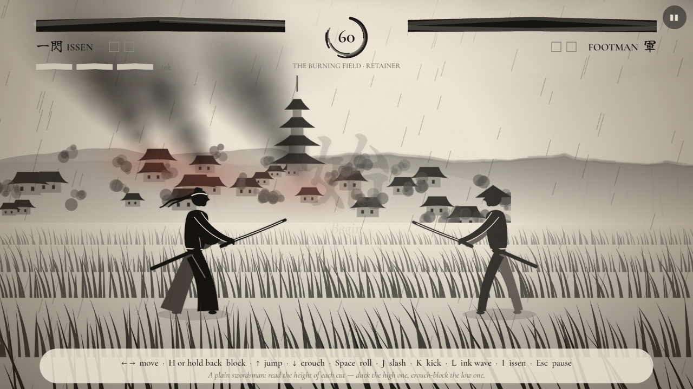
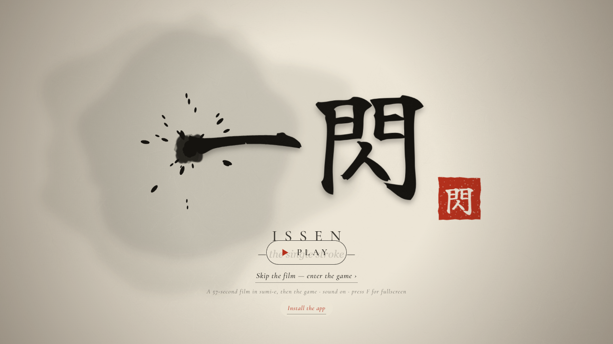
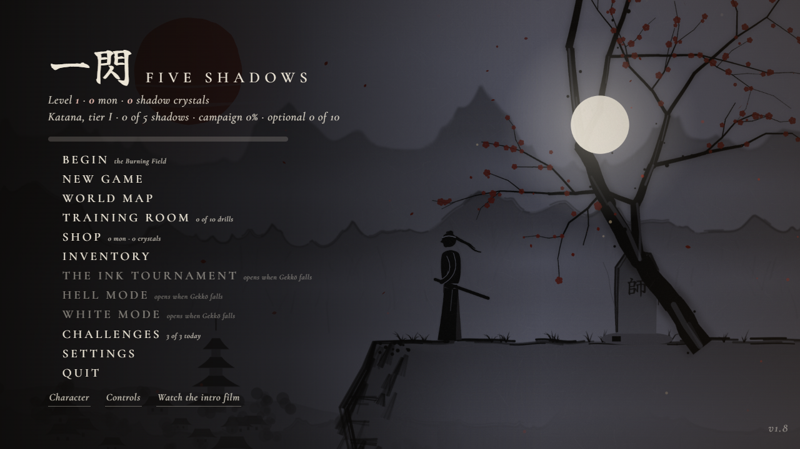
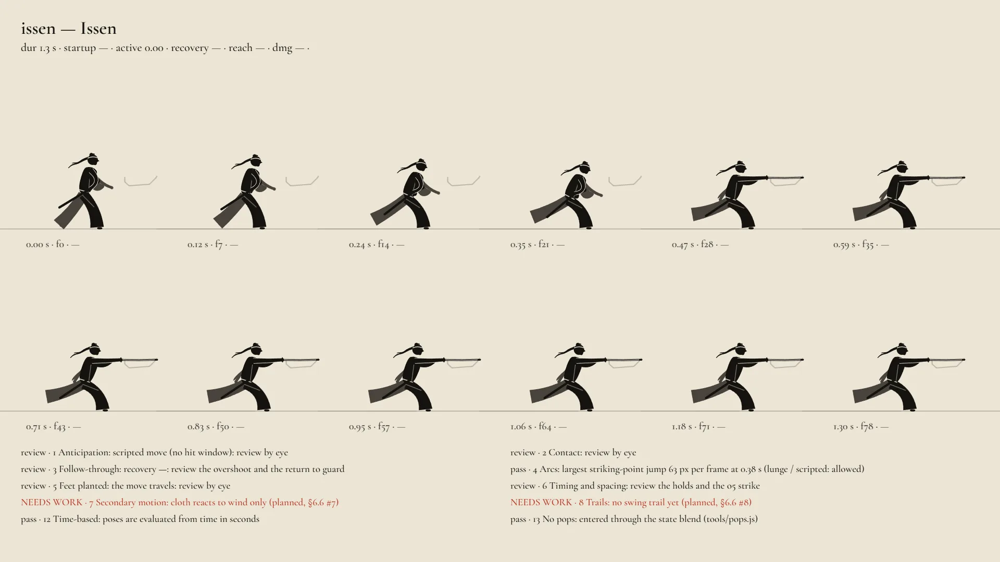

# 一閃 Issen: Five Shadows

**[▶ Play in your browser](https://sanokiyo1029-sys.github.io/issen-five-shadows/)** · **[Download the Android APK](https://sanokiyo1029-sys.github.io/issen-five-shadows/Issen-FiveShadows.apk)** · v1.8

An ink-painted samurai game. It opens with a 57-second sumi-e film, then hands you the sword: a duel RPG across five regions, each ruled by a Shadow.



| | |
|---|---|
|  |  |

## The game

- **Five Shadows, five regions.** Each region has retainers, two lieutenants who teach the Shadow's moves, an optional elite, and then the Shadow.
- **Reads, not button-mashing.** Every cut is high or low, so you duck one and crouch-block the other. Parries, throws (Block + Kick), rolls, the ink wave and *issen*, the single stroke.
- **RPG layer.** Levels, attributes, weapon tiers, a shop, gear and a respec route. The economy is simulated in `tools/economy.js` so repeat fights pay fairly.
- **More modes.** The Ink Tournament, Hell Mode, White Mode, daily challenges, a training room with frame data, and a map editor.
- **Plays anywhere.** Keyboard, touch or gamepad. It installs as a PWA and works offline, or runs as an Android APK.

**Controls:** `←` `→` move · `H` / hold back to block · `↑` jump · `↓` crouch · `Space` roll · `J` slash · `K` kick · `L` ink wave · `I` issen · `Esc` pause

## How it's built

One `index.html`, about 440 KB. It uses vanilla JavaScript, Canvas 2D and Web Audio, with no framework and no build step. The game data lives in JSON `<script>` blocks, and a network-first service worker makes it work offline.

The testing is what I'm proudest of:

- **173 automated tests** across 31 files (`node tests/run.js`). They cover combat, saves, the economy and every mode.
- **A golden baseline** that fails if a boss move, a boss or the default hero changes by accident.
- **Crash-safe saves.** Each reward is staged and rolled back if the write fails. A save from a newer version is never overwritten. See [`docs/save-format.md`](docs/save-format.md).
- **Smoke runs** in headless Chrome over every screen with a clean console (`tools/smoke.js`), plus a check that boots the APK's own page (`tools/apk-check.js`).
- **Animation review sheets**, generated frame by frame for every move:



## Docs

[Changelog](docs/changelog.md) · [Feature status](docs/status.md) · [Test report](docs/test-report.md) · [Moves & frame data](docs/moves.md) · [Economy](docs/economy.md) · [Release](docs/release.md)

## Run it locally

```bash
node tools/serve.js
```

Then open http://localhost:8779. It needs no dependencies. To run the tests:

```bash
node tests/run.js
```

---

Made by [Rohan Kumar](https://github.com/sanokiyo1029-sys).
